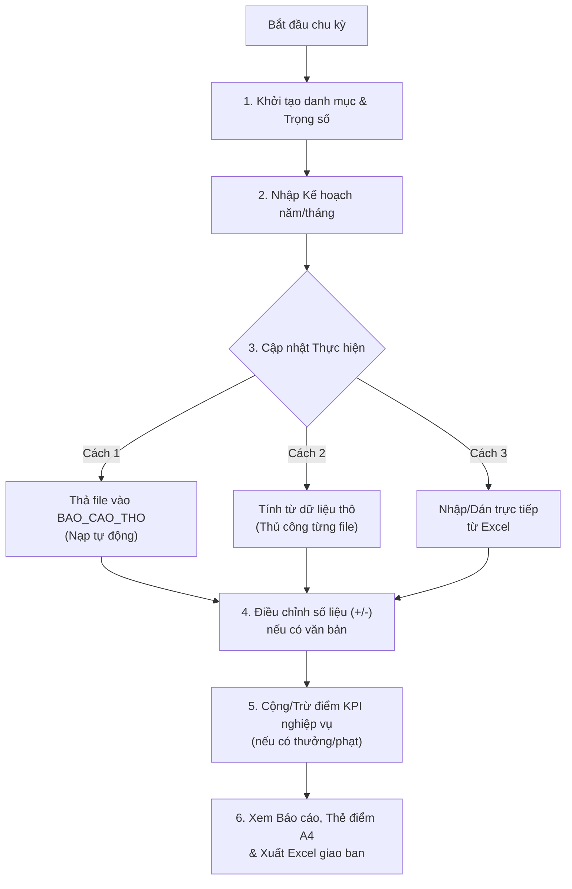

# HỆ THỐNG QUẢN TRỊ & CHẤM ĐIỂM KPI CÁC PHÒNG / PGD
## VIETINBANK CHI NHÁNH BẮC NGHỆ AN (MÃ CN: 444)
**Phiên bản:** `2.12.0` (Phát hành: `08/11/2026`)  
**Môi trường:** Chạy Offline / Mạng nội bộ (LAN / Shared Drive), không cần cài đặt Web Server hay Backend phức tạp.  

---

## MỤC LỤC
1. [Giới thiệu tổng quan](#1-giới-thiệu-tổng-quan)
2. [Kiến trúc & Cấu trúc thư mục](#2-kiến-trúc--cấu-trúc-thư-mục)
3. [Các tính năng nổi bật (v2.5.0)](#3-các-tính-năng-nổi-bật-v250)
4. [Hướng dẫn cài đặt & Triển khai](#4-hướng-dẫn-cài-đặt--triển-khai)
5. [Hướng dẫn sử dụng & Quy trình vận hành](#5-hướng-dẫn-sử-dụng--quy-trình-vận-hành)
6. [Quy tắc chấm điểm & Công thức nghiệp vụ](#6-quy-tắc-chấm-điểm--công-thức-nghiệp-vụ)
7. [Cơ chế đồng bộ đa máy & Bảo mật](#7-cơ-chế-đồng-bộ-đa-máy--bảo-mật)
8. [Tài liệu Schema dữ liệu](#8-tài-liệu-schema-dữ-liệu)
9. [Giao diện mới (Dual UI)](#9-giao-diện-mới-dual-ui)

---

## 1. GIỚI THIỆU TỔNG QUAN

Hệ thống Quản trị & Chấm điểm KPI là ứng dụng Web chạy trực tiếp trên trình duyệt hiện đại (Google Chrome, Microsoft Edge) phục vụ công tác giao kế hoạch, theo dõi tiến độ và chấm điểm KPI hàng tháng cho:
- **Từng Phòng/PGD nghiệp vụ:** Khối Khách hàng doanh nghiệp (KHDN), Khối Khách hàng cá nhân / Bán lẻ (KHCN), Khối Phòng giao dịch (PGD), Khối Hỗ trợ (HTTD, DVKH, TCTH...).
- **Toàn Chi nhánh:** Thẻ điểm tổng hợp của Chi nhánh Bắc Nghệ An (Khối CN).

### Điểm đặc thù kiến trúc:
- **Zero Backend / Serverless:** Chạy trực tiếp từ file tĩnh HTML/JS/CSS, không phụ thuộc vào Node.js, Python, Java hay cơ sở dữ liệu SQL Server/MySQL trên máy chủ.
- **Lưu trữ & Đồng bộ tệp JSON (File System Access API):** Dữ liệu được lưu trong tệp `Data/KPI_CHI_NHANH.json` trên ổ đĩa mạng chia sẻ. Cơ chế đồng bộ cấp ô (*Cell-level Last-Write-Wins*) cho phép nhiều máy cùng truy cập và cập nhật mà không sợ ghi đè mất dữ liệu.
- **Hiệu năng cao:** Toàn bộ công cụ tính toán KPI, ma trận xếp hạng, cảnh báo điều hành và phân tích xu hướng chạy chỉ trong ~2–3 ms. Thư viện nặng (SheetJS ~880 KB, Chart.js ~200 KB, Tabulator ~470 KB) chỉ được nạp động khi người dùng thực hiện thao tác tương ứng.

---

## 2. KIẾN TRÚC & CẤU TRÚC THƯ MỤC

```text
KPI_CN444/
│
├── DOC_TRUOC.txt                   # Ghi chú tổng hợp v2.5.0 từ nhóm phát triển
├── README.md                       # Tài liệu hướng dẫn sử dụng và triển khai dự án
├── SCHEMA.md                       # Tài liệu đặc tả Schema dữ liệu kỹ thuật
│
├── App/                       # Mã nguồn ứng dụng Web client-side
│   ├── index.html                  # Điểm khởi chạy ứng dụng (Mở bằng Chrome/Edge)
│   ├── assets/                     # Tài nguyên đồ họa, logo VietinBank
│   │   ├── logo-vietinbank.png
│   │   └── logo.svg
│   ├── css/
│   │   └── app.css                 # Giao diện chuẩn nhận diện thương hiệu VietinBank
│   ├── js/                         # Bộ mã nguồn JavaScript module hóa
│   │   ├── config.js               # Cấu hình danh mục mặc định, phiên bản, ngưỡng
│   │   ├── engine.js               # Động cơ tính điểm KPI & mô hình dữ liệu (Model)
│   │   ├── store.js                # Quản lý State, LocalStorage, đồng bộ File System
│   │   ├── cong-thuc.js            # Engine xử lý công thức ETL dữ liệu thô (AutoKPI)
│   │   ├── nap-tu-dong.js          # Module quét và nạp file báo cáo thô tự động
│   │   ├── excel.js                # Bộ đọc/ghi và xuất báo cáo Excel đa trang
│   │   ├── ui.js                   # Tiện ích giao diện, format số, hộp thoại, thông báo
│   │   ├── app.js                  # Điều hướng router, khởi tạo ứng dụng
│   │   ├── views-diem-kpi.js       # Màn hình Điểm KPI & Thẻ điểm chi tiết
│   │   ├── views-chi-tieu.js       # Màn hình Ma trận chỉ tiêu, Xếp hạng & Theo dõi
│   │   ├── views-theo-doi.js       # Màn hình Diễn biến 12 tháng & Xu hướng ngày
│   │   ├── views-du-lieu-tho.js    # Màn hình Tính KPI từ dữ liệu thô thủ công
│   │   ├── views-nap-tu-dong.js    # Màn hình Quản trị tiến trình Nạp tự động
│   │   ├── views-dieu-chinh.js     # Màn hình Điều chỉnh số liệu (+/-) có căn cứ
│   │   └── views-quan-tri.js       # Quản trị Danh mục, Trọng số, Cài đặt & Users
│   └── lib/                        # Thư viện bên thứ ba (chạy offline độc lập)
│       ├── chart.umd.min.js        # Thư viện vẽ biểu đồ Chart.js (kèm plugin annotation, datalabels)
│       ├── xlsx.full.min.js        # Thư viện đọc/ghi bảng tính SheetJS
│       ├── tabulator.min.js/.css   # Bảng có sắp xếp theo cột (Tabulator)
│       └── ...                     # PptxGenJS, docx, SortableJS, SnapDOM, xlsx-js-style
│
├── Data/                        # THƯ MỤC DÙNG CHUNG (Lưu trên ổ mạng chung LAN)
│   ├── HUONG_DAN.txt               # Hướng dẫn cấu hình ổ mạng
│   ├── KPI_CHI_NHANH.json          # File dữ liệu JSON trung tâm của hệ thống
│   ├── BAO_CAO_THO/                # Thư mục thả file Excel/CSV thô để nạp tự động
│   │   └── HUONG_DAN.txt
│   └── NAP_TU_DONG/                # Sổ theo dõi tệp đã nạp và khóa tiến trình
│       ├── DA_NAP.json             # Sổ nhật ký tệp thô đã xử lý
│       └── KHOA.json               # Phân tán mutex lock chống nạp trùng
│
└── VI_DU_DU_LIEU_THO/              # Mẫu báo cáo thô từ hệ thống Core/MIS
    ├── BCCV_15.11.2026.xlsx        # File mẫu Báo cáo cho vay giữa tháng
    ├── BCCV_30.11.2026.xlsx        # File mẫu Báo cáo cho vay cuối tháng
    ├── BCCV_T10_2026.xlsx          # File mẫu Báo cáo cho vay tháng 10
    ├── BCNV_T10_2026.xlsx          # File mẫu Báo cáo nguồn vốn tháng 10
    └── DOC_TRUOC.txt               # Giải thích định dạng dữ liệu mẫu
```

---

## 3. CÁC TÍNH NĂNG NỔI BẬT (v2.5.0)

### 3.0. Bảng sắp xếp được
- Các bảng chỉ xem (Xếp hạng, Dự báo cuối năm, Kiểm tra số…) dùng Tabulator: bấm tiêu đề cột để sắp xếp tăng dần, giảm dần, bấm lần ba để về thứ tự ban đầu. Bảng nhập liệu, heatmap và bảng có gộp ô giữ nguyên.

### 3.1. Chấm điểm & Xếp hạng KPI đa chiều
- Chấm điểm KPI cho từng **Phòng ban / PGD** theo đặc thù khối (KHDN, KHCN, PGD, Dịch vụ & hỗ trợ) và **Toàn chi nhánh**.
- Chấm điểm trên **Điểm quy đổi thang 100**, giúp việc xếp hạng thi đua công bằng giữa các phòng ngay cả khi tổng trọng số giao khác nhau.
- Thẻ điểm KPI phòng chuẩn A4, hiển thị rõ số kế hoạch, thực hiện, tỷ lệ hoàn thành (%HT), điểm đạt được, điểm mất đi, kèm ô ghi nhận xét của Ban Giám đốc và giải pháp của đơn vị.

### 3.2. Động cơ tính toán linh hoạt (AutoKPI Engine)
- Tự động đọc và gom số liệu từ các file báo cáo thô (BCCV, BCNV, CSV...) xuất từ CoreBanking/MIS.
- Hỗ trợ các hàm gom nhóm: `Tổng`, `Đếm số dòng`, `Đếm không trùng (CIF/Mã KH)`, `Trung bình`, `Lớn nhất`, `Nhỏ nhất`, `Tỷ lệ % (Tử số / Mẫu số)`.
- Nhận diện cột theo tên (không phụ thuộc thứ tự cột), hỗ trợ cả định dạng số chuẩn Việt Nam (`1.234.567,89`) và quốc tế (`1,234,567.89`).
- Tự động trừ mốc cho các chỉ tiêu tăng trưởng (so với 31/12 năm trước hoặc số gốc nhập tay).

### 3.3. Nạp tự động từ thư mục & Diễn biến theo ngày (v2.2.0)
- Quét định kỳ thư mục `Data/BAO_CAO_THO` (hoặc thư mục nội bộ máy cá nhân).
- Tự động nhận diện kỳ báo cáo qua cột "Ngày báo cáo" hoặc tên tệp.
- Chế độ nạp: "Hỏi trước" (xem trước kết quả trước khi ghi) hoặc "Tự ghi".
- Chốt số ngày cuối tháng thành số thực hiện tháng; ô đã sửa tay sau nạp tự động được bảo toàn.
- Khóa phân tán (`KHOA.json`) đảm bảo trong cùng thời điểm chỉ duy nhất 1 máy thực hiện nạp dữ liệu.

### 3.4. Điều chỉnh số liệu thủ công có căn cứ (v2.3.0)
- Cho phép cộng/trừ số thực hiện (Dư nợ BQ, Nguồn vốn BQ, CASA...) khi có quyết định điều chuyển hoặc sự kiện phát sinh.
- Giao diện 1 bảng cho toàn bộ các phòng và Toàn CN; hỗ trợ dán thẳng cột số từ Excel.
- Bắt buộc ghi chú lý do và căn cứ văn bản (VD: Quyết định số...); xuất danh sách điều chỉnh ra Excel lưu hồ sơ kiểm tra.
- Bảo tồn số gốc: Nạp lại file thô không làm mất số đã điều chỉnh.

### 3.5. Ma trận chỉ tiêu trực quan (v2.4.0)
- Chế độ xem đa dạng: `% Hoàn thành KH`, `Thứ hạng chỉ tiêu` (tô màu theo nhóm đầu/giữa/cuối), `% Kế hoạch cả năm`.
- Bảng màu linh hoạt (Heatmap): Excel đỏ-vàng-xanh, ColorBrewer RdYlGn, Đơn sắc xanh dương (chuẩn cho in đen trắng và người khiếm thị màu sắc).

### 3.6. Theo dõi diễn biến chỉ tiêu (v2.5.0)
- Theo dõi chuyên sâu các chỉ tiêu số dư và lũy kế mà không ảnh hưởng điểm KPI: Dư nợ cuối kỳ, Nguồn vốn cuối kỳ, CASA cuối kỳ.
- 3 chế độ xem: **So sánh kỳ** (so tháng trước, so đầu năm, so cùng kỳ năm trước), **Diễn biến 12 tháng** (bảng số liệu + biểu đồ đa đường), **Kế hoạch & Điểm**.

### 3.7. Quản trị phân quyền & Bảo mật mật khẩu
- Đăng nhập bảo vệ các chức năng Quản trị & Nhập số.
- Mật khẩu được mã hóa an toàn bằng thuật toán chuẩn **PBKDF2 SHA-256** với Salt ngẫu nhiên và 150.000 vòng lặp (vượt trội so với mã PIN đơn giản).
- Hỗ trợ tạo nhiều tài khoản người dùng, đổi mật khẩu và phân quyền vận hành.

---

## 4. HƯỚNG DẪN CÀI ĐẶT & TRIỂN KHAI

### Bước 1: Chuẩn bị thư mục dữ liệu chung `Data`
1. Chọn một thư mục chia sẻ trên mạng nội bộ cơ quan (Shared Drive / SMB / NAS) mà tất cả các máy trạm cần xem KPI đều truy cập được (Ví dụ: `Z:\KPI_Data` hoặc `\\10.x.x.x\KPI\Data`).
2. Chép toàn bộ thư mục `Data` trong bộ cài đặt lên vị trí mạng đó.
3. **Phân quyền mạng Windows (NTFS / Share Permissions):**
   - **Cán bộ quản trị / Người nhập số (Phòng Tổng hợp):** Quyền `Read & Write` (Đọc và Ghi).
   - **Ban Giám đốc & Các Phòng/PGD chỉ xem:** Quyền `Read-Only` (Chỉ đọc) để đảm bảo an toàn tuyệt đối.

### Bước 2: Triển khai ứng dụng trên máy người dùng
1. Chép thư mục `App` về máy trạm (hoặc đặt cạnh `Data` trên ổ đĩa chung).
2. Dùng **Google Chrome** hoặc **Microsoft Edge** phiên bản mới mở tệp `App\index.html`.
3. Tạo phím tắt (Shortcut) ra màn hình Desktop để tiện truy cập hàng ngày.

### Bước 3: Kết nối ứng dụng với dữ liệu dùng chung (Làm lần đầu)
1. Trên giao diện Web, bấm nút **"Mở khóa quản trị"** (Góc trên bên phải).
   - Tài khoản mặc định: `admin`
   - Mật khẩu mặc định: `1111`
2. Vào menu **Dữ liệu & Cài đặt**:
   - Tại mục *Thư mục dữ liệu dùng chung*, bấm nút **"Chọn thư mục Data"**.
   - Trình duyệt sẽ mở hộp thoại cấp quyền, chọn đúng thư mục `Data` trên ổ mạng và bấm **"Select Folder"** -> bấm **"Allow" / "Cho phép"**.
   - Trạng thái sẽ chuyển sang: `Đang đồng bộ với "Data"`.
3. **Đổi mật khẩu tài khoản quản trị:** Tại bảng *Người dùng quản trị*, bấm nút **"Đổi MK"** cho tài khoản `admin` để đặt mật khẩu an toàn mới.

### Bước 4: Cơ chế tự động kết nối lại ở các lần mở tiếp theo
- **Số liệu hiện ngay:** Khi mở `index.html`, số liệu lưu trên máy từ lần trước hiển thị tức thì.
- **Tự động xin lại quyền:** Lần bấm chuột hoặc gõ phím đầu tiên ở bất kỳ đâu trên trang sẽ tự động xin lại quyền đọc/ghi thư mục `Data` (và thư mục phụ `Downloads` nếu có) để lấy số mới nhất về.
- **Tùy chọn "Cho phép mỗi lần truy cập" (Allow on every visit):** Trong hộp thoại của Chrome/Edge bản mới, hãy chọn mục này. Từ lần sau, ứng dụng sẽ tự động kết nối ngầm mà không cần hiện hộp thoại hỏi quyền nữa.
- **Nếu lỡ bấm Từ chối:** Ứng dụng không hỏi lặp lại trên các thao tác tiếp theo trong phiên mở đó để tránh gây phiền. Trên dải thông báo đầu trang và biểu tượng đồng bộ ở thanh trên vẫn có sẵn nút **"Kết nối lại"** để bấm kết nối lại bất cứ lúc nào.

---

## 5. HƯỚNG DẪN SỬ DỤNG & QUY TRÌNH VẬN HÀNH



### 5.1. Nhập Kế hoạch (Giao chỉ tiêu)
1. Vào menu **Quản trị › Nhập kế hoạch & thực hiện**.
2. Chọn tab **"Kế hoạch lũy kế"** và chọn kỳ tháng/năm cần nhập.
3. Thao tác nhanh:
   - Gõ số trực tiếp, dùng `Enter` / `Tab` để di chuyển.
   - **Dán từ Excel:** Copy cả vùng số trong Excel và bấm `Ctrl+V` vào ô đầu tiên trong bảng.
   - Dùng nút **"Phân bổ KH năm"** để tự động chia kế hoạch cả năm cho 12 tháng theo tỷ trọng tùy chọn.

### 5.2. Nạp số thực hiện từ file báo cáo thô
- **Nạp tự động (Khuyến nghị):**
  1. Thả file báo cáo `BCCV_...` hoặc `BCNV_...` vào thư mục `Data\BAO_CAO_THO`.
  2. Ứng dụng khi đang mở sẽ tự quét mỗi phút. Biểu tượng tia sét ⚡ trên thanh điều hướng sẽ hiển thị số file chờ duyệt.
  3. Bấm vào biểu tượng ⚡ để kiểm tra kết quả tính toán và bấm **"Ghi vào hệ thống"**.
- **Tính thủ công:**
  1. Vào menu **Tính từ dữ liệu thô**.
  2. Kéo thả file Excel/CSV vào vùng tải lên.
  3. Chọn công thức phù hợp và bấm **"Tính và Ghi kết quả"**.

### 5.3. Nhập điều chỉnh số liệu thủ công
1. Vào menu **Điều chỉnh số liệu**.
2. Chọn Chỉ tiêu cần điều chỉnh (Dư nợ BQ, Nguồn vốn BQ, CASA BQ...).
3. Chọn Tháng bắt đầu và Phạm vi (*Chỉ tháng này* hoặc *Đến hết năm*).
4. Nhập số tiền cộng (+) hoặc trừ (-) cho từng phòng ban.
5. Ghi rõ **Lý do** và **Căn cứ văn bản** để phục vụ hậu kiểm. Bấm **"Lưu điều chỉnh"**.

### 5.4. Xuất báo cáo & In Thẻ điểm
- **Thẻ điểm KPI phòng:** Vào **Chi tiết phòng/PGD** -> Chọn phòng ban -> Bấm **"In thẻ điểm A4"** (Giao diện tối ưu chuẩn trang in, ẩn các nút bấm không cần thiết).
- **Xuất Excel toàn diện:** Vào **Xem điểm KPI** hoặc **Ma trận chỉ tiêu** -> Bấm **"Xuất báo cáo Excel"**. File xuất ra chứa đầy đủ các Sheet:
  1. `DIEM_KPI`: Điểm tổng hợp và thứ hạng các phòng.
  2. `CHI_TIET_PHONG`: Toàn bộ chỉ tiêu của từng đơn vị.
  3. `MA_TRAN_PT`: Ma trận % hoàn thành của từng phòng x từng chỉ tiêu.
  4. `HANG_CHI_TIEU`: Thứ hạng của từng phòng ở từng chỉ tiêu.
  5. `KH_NAM`: Tiến độ hoàn thành kế hoạch năm.

---

## 6. QUY TẮC CHẤM ĐIỂM & CÔNG THỨC NGHIỆP VỤ

### 6.1. Tỷ lệ hoàn thành (%HT)
Tùy thuộc vào đặc tính của từng chỉ tiêu, tỷ lệ hoàn thành được tính theo 3 công thức:
1. **Chỉ tiêu Càng cao càng tốt (`cao_tot`):**
   $$\%HT = \frac{\text{Thực hiện}}{\text{Kế hoạch}}$$
2. **Chỉ tiêu Càng thấp càng tốt (`thap_tot`, ví dụ Tỷ lệ nợ xấu):**
   $$\%HT = \begin{cases} 
   \text{\% Tối đa} & \text{nếu Thực hiện} = 0 \\ 
   \frac{\text{Kế hoạch}}{\text{Thực hiện}} & \text{nếu Thực hiện} > 0 
   \end{cases}$$
3. **Chỉ tiêu Nhập thẳng tỷ lệ (`nhap_ty_le`, ví dụ Điểm CX):**
   $$\%HT = \frac{\text{Thực hiện}}{100}$$

### 6.2. Quy tắc tính Điểm KPI
- **Điểm chỉ tiêu:**
  $$\text{Điểm} = \text{Trọng số} \times \min\left(\max(\%HT, 0), \text{\% Tối đa}\right)$$
  *(Mặc định % tối đa được khống chế là 130% tương đương hệ số 1.3)*.
- **Điểm mất đi:**
  $$\text{Điểm mất} = \max\left(0, \text{Trọng số} - \text{Điểm}\right)$$
- **Xử lý thiếu số liệu hoặc số âm:**
  - Nếu thiếu Kế hoạch hoặc thiếu Thực hiện: Chấm **0 điểm**, mất toàn bộ trọng số của chỉ tiêu đó.
  - Nếu Thực hiện có giá trị âm ($TH < 0$): Chấm **0 điểm**, mất toàn bộ trọng số.
- **Điểm quy đổi thang 100:**
  $$\text{Điểm quy đổi 100} = \frac{\sum \text{Điểm đạt}}{\sum \text{Trọng số áp dụng}} \times 100$$
  *Quy đổi giúp so sánh công bằng giữa các phòng thuộc các khối có tổng trọng số khác nhau.*

### 6.3. Tiêu chuẩn xếp loại đánh giá
Hệ thống phân loại theo ngưỡng cấu hình mặc định:
- **Đạt:** $\%HT \ge 100\%$ (Màu xanh lục)
- **Khá:** $80\% \le \%HT < 100\%$ (Màu xanh dương)
- **Cần cải thiện:** $70\% \le \%HT < 80\%$ (Màu vàng cam)
- **Chưa đạt:** $\%HT < 70\%$ (Màu đỏ)

---

## 7. CƠ CHẾ ĐỒNG BỘ ĐA MÁY & BẢO MẬT

### 7.1. Thuật toán đồng bộ LWW (Last-Write-Wins per cell)
- Khác với việc ghi đè cả tệp JSON (dễ gây mất dữ liệu khi 2 người cùng nhập), hệ thống lưu trữ từng ô số liệu dưới dạng bộ đôi: `[Giá trị, Dấu thời gian ms]`.
- Khi máy A lưu vào `Data/KPI_CHI_NHANH.json`, hệ thống sẽ đọc lại tệp trên đĩa, so sánh từng ô:
  - Nếu thời gian cập nhật của ô trên máy mới hơn -> Ghi đè ô đó.
  - Nếu thời gian của máy khác mới hơn -> Giữ nguyên số của máy khác.
- Các máy trạm đang mở ứng dụng sẽ tự động kiểm tra và làm mới dữ liệu sau mỗi 20 giây.

### 7.2. Bảo mật đăng nhập & Phân quyền
- **Mã hóa PBKDF2 SHA-256:**
  - Salt ngẫu nhiên 16 bytes (Base64).
  - Khóa suy dẫn 256-bit chạy qua 150.000 vòng băm lặp (Iterations).
  - Không bao giờ lưu mật khẩu ở dạng văn bản rõ (Plaintext).
- **Phân tách vai trò:**
  - **Khách / Toàn thể cán bộ:** Chỉ xem báo cáo, tra cứu điểm và xuất file Excel.
  - **Quản trị viên (Admin):** Mở khóa bằng tài khoản để chỉnh sửa danh mục, nhập số liệu, cấu hình ngưỡng và nạp dữ liệu.

---

## 8. TÀI LIỆU SCHEMA DỮ LIỆU

Để tìm hiểu chi tiết về cấu trúc dữ liệu JSON, các trường dữ liệu, quan hệ thực thể, ràng buộc kiểu dữ liệu và thông số API của hệ thống, vui lòng tham khảo tài liệu chuyên sâu:
👉 **[SCHEMA.md](SCHEMA.md)**

---
**Bộ phận phát triển & Quản trị KPI — VietinBank Chi nhánh Bắc Nghệ An**  
*Mọi ý kiến đóng góp hoặc yêu cầu hỗ trợ kỹ thuật, vui lòng liên hệ phòng Tổng hợp CN 444.*


---

## 9. GIAO DIỆN MỚI (DUAL UI)

Ứng dụng có **hai giao diện dùng chung một nguồn dữ liệu và engine KPI**: **Giao diện cũ** (mặc định, giữ nguyên) và **Giao diện mới** (Design System VietinBank). Chi tiết: `IMPLEMENTATION_REPORT.md`, `DESIGN_SYSTEM.md`, `TEST_REPORT.md`.

### 9.1. Chuyển đổi giao diện
- Nút **Giao diện cũ | Giao diện mới** ở **header** (cả hai giao diện). Chuyển tức thì, không đăng nhập lại, không mất dữ liệu; **kỳ báo cáo, màn hình, đơn vị, chỉ tiêu, nhóm đơn vị** đang xem được giữ nguyên.
- Lựa chọn được **ghi nhớ trên máy** (`localStorage`, khoá `KPI_CN444.giao_dien`); mở lại ứng dụng sẽ dùng giao diện đã chọn gần nhất. Lần đầu mặc định là giao diện cũ.
- Nếu giao diện mới nạp lỗi hoặc gặp sự cố khi vẽ, ứng dụng tự quay về giao diện cũ và báo trên màn hình.
- Chưa có tài khoản theo người dùng ở phía máy chủ nên lựa chọn lưu theo trình duyệt/máy.

### 9.2. Giao diện mới
- **Thiết kế lại:** Tổng quan chi nhánh · Điều hành Ban giám đốc · Phân tích chi tiết (Theo dõi chỉ tiêu) · Xếp hạng · Ma trận chỉ tiêu (ma trận trạng thái, không dùng thang cầu vồng) · Thẻ điểm KPI phòng · Nội dung cần xử lý.
- **Các màn còn lại** (nhập liệu, quản trị, báo cáo…) hiển thị bản cũ trong khung mới với bảng màu mới.
- Màu trạng thái KPI thống nhất: Đạt `#1c5cab` · Khá `#6da7ec` · Cần cải thiện `#ec835a` · Chưa đạt `#b02a2a` · GAP `#8996ab`, luôn kèm biểu tượng + chữ.
- Mọi biểu đồ có nút **Bảng** (dạng bảng số thay thế). Đường **DỰ KIẾN** vẽ nét đứt có nhãn; chỉ hiển thị khi chức năng Dự báo của hệ thống có số.
- Bấm một đơn vị ở xếp hạng → xuống chỉ tiêu của đơn vị; bấm một chỉ tiêu → biểu đồ kế hoạch/thực hiện và tăng trưởng.

### 9.3. Presentation Mode (họp giao ban)
Nút **Trình chiếu** (trên Tổng quan và Điều hành BGĐ): khung 16:9 tham chiếu 1920×1080, tự co giãn theo cửa sổ (hỗ trợ 1920×1080, 1440×900, 1366×768), chữ lớn, chỉ giữ số liệu quan trọng. **← / →** chuyển hai màn hình; **Esc** hoặc nút *Thoát trình chiếu* để thoát; F11 để toàn màn hình thật.

### 9.4. Cấu hình ngưỡng điểm cao (D7)
`settings.nguong.diem_cao` (mặc định **90**) quyết định số "Đơn vị ≥ N điểm" ở Tổng quan, dùng chung cho hai giao diện. Chỉnh trong **Dữ liệu & cài đặt → Ngưỡng điểm cao**. Dữ liệu cũ chưa có khoá này tự nhận 90 nên kết quả không đổi.

### 9.5. Kiểm thử
```
node tests\test-nguong.js    <đường dẫn tuyệt đối>\App\js
node tests\test-moi-data.js  <đường dẫn tuyệt đối>\App\js
node tests\browser-dual-ui.mjs        (cần Edge/Chrome; hồ sơ tạm, dữ liệu mẫu)
node tests\screenshots-dual-ui.mjs    (ảnh vào docs\screenshots)
```
