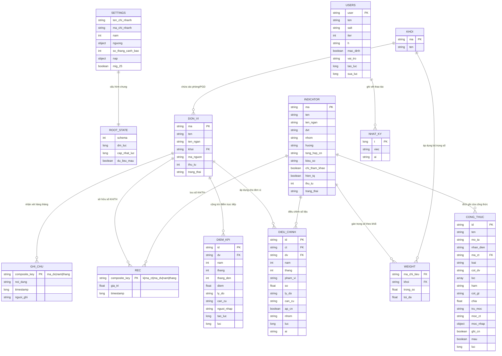
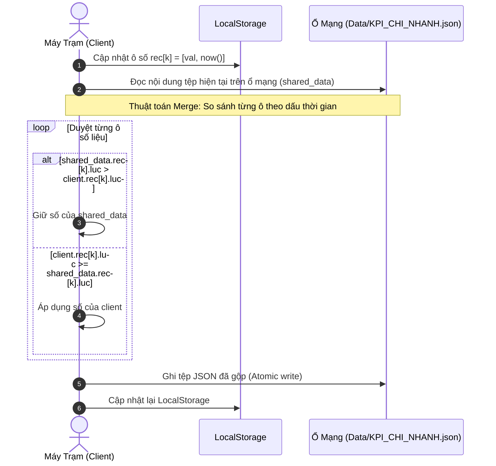

# TÀI LIỆU ĐẶC TẢ SCHEMA DỮ LIỆU
## HỆ THỐNG KPI CÁC PHÒNG — VIETINBANK BẮC NGHỆ AN (CN 444)
**Schema Version:** `2`  
**Định dạng lưu trữ chính:** JSON Document (`Data/KPI_CHI_NHANH.json`)  
**Mô hình lưu trữ:** Client-side State, LocalStorage Cache, Shared Network File System Sync (Conflict-Free Last-Write-Wins per cell).

---

## 1. SƠ ĐỒ QUAN HỆ THỰC THỂ (ENTITY RELATIONSHIP DIAGRAM)



---

## 2. CHI TIẾT CÁC THỰC THỂ DỮ LIỆU CHÍNH

### 2.1. Cấu trúc Gốc (Root Document)
File trung tâm: `Data/KPI_CHI_NHANH.json`

| Tên trường | Kiểu dữ liệu | Bắt buộc | Mô tả |
| :--- | :--- | :---: | :--- |
| `schema` | `Integer` | Có | Phiên bản schema cấu trúc dữ liệu (hiện tại là `2`). |
| `settings` | `Object` | Có | Chứa các cấu hình toàn cục của hệ thống và chi nhánh. |
| `khoi` | `Array<Khoi>` | Có | Danh sách các khối phòng ban nghiệp vụ. |
| `don_vi` | `Array<DonVi>` | Có | Danh sách các Phòng ban / PGD thuộc chi nhánh. |
| `indicators` | `Array<Indicator>` | Có | Danh mục các chỉ tiêu KPI chấm điểm và theo dõi. |
| `weights` | `Array<Weight>` | Có | Ma trận trọng số và tỷ lệ hoàn thành tối đa theo khối. |
| `rec` | `Object<string, [number|null, long]>` | Có | Kho lưu trữ giá trị số liệu Kế hoạch và Thực hiện (Key-Value Map). |
| `ghi_chu` | `Object<string, [string, long, string?]>` | Có | Nhận xét của Ban Giám đốc và giải pháp của đơn vị theo kỳ. |
| `dieu_chinh` | `Array<DieuChinh>` | Có | Danh sách các bút toán điều chỉnh số liệu thủ công (+/-). |
| `diem_kpi` | `Array<DiemKpi>` | Có | Danh sách các khoản cộng/trừ điểm KPI tổng thể trực tiếp. |
| `so_ngay` | `Object<string, SnapshotNgay>` | Có | Ảnh chụp số liệu theo ngày từ tiến trình nạp tự động. |
| `tu_dong_ghi` | `Object<string, long>` | Có | Nhật ký mốc thời gian ghi tự động theo từng ô số liệu. |
| `cong_thuc` | `Array<CongThuc>` | Có | Bộ quy tắc công thức bóc tách dữ liệu báo cáo thô (AutoKPI). |
| `users` | `Array<User>` | Có | Danh sách tài khoản quản trị và thông tin băm mật khẩu. |
| `nhat_ky` | `Array<NhatKy>` | Có | Nhật ký kiểm toán thao tác người dùng (giữ tối đa 300 bản ghi mới nhất). |
| `dm_luc` | `Long` | Có | Timestamp cập nhật danh mục lần cuối (ms). |
| `cap_nhat_luc` | `Long` | Có | Timestamp cập nhật số liệu hoặc trạng thái lần cuối (ms). |
| `du_lieu_mau` | `Boolean` | Có | Cờ đánh dấu hệ thống đang ở trạng thái dữ liệu mẫu (`true`/`false`). |

---

### 2.2. Chi tiết thực thể `settings` (Cài đặt hệ thống)

```json
{
  "ten_chi_nhanh": "VietinBank Chi nhánh Bắc Nghệ An",
  "ma_chi_nhanh": "444",
  "nam": 2026,
  "nguong": {
    "dat": 1.0,
    "kha": 0.8,
    "cct": 0.7,
    "diem_cao": 90
  },
  "so_thang_canh_bao": 2,
  "nap": {
    "bat": true,
    "che_do": "hoi",
    "ghi_th": "luon"
  },
  "mig_25": true,
  "pin_hash": {
    "salt": "...",
    "iter": 150000,
    "h": "..."
  },
  "pin_mac_dinh": true
}
```

| Thuộc tính | Kiểu dữ liệu | Mặc định | Ý nghĩa & Quy tắc |
| :--- | :--- | :--- | :--- |
| `ten_chi_nhanh` | `String` | `'VietinBank Chi nhánh Bắc Nghệ An'` | Tên hiển thị của chi nhánh trên giao diện, báo cáo và bản in A4. |
| `ma_chi_nhanh` | `String` | `'444'` | Mã định danh đơn vị trên hệ thống Core / MIS của ngân hàng. |
| `nam` | `Integer` | `2026` | Năm tài chính / kỳ đánh giá KPI mặc định khi mở ứng dụng. |
| `nguong.dat` | `Float` | `1.0` | Ngưỡng tỷ lệ hoàn thành đạt loại **Đạt** ($\ge 100\%$). |
| `nguong.kha` | `Float` | `0.8` | Ngưỡng tỷ lệ hoàn thành đạt loại **Khá** ($\ge 80\%$). |
| `nguong.diem_cao` | `Float` | `90` | **Ngưỡng điểm** (điểm quy đổi thang 100) để đếm "Đơn vị ≥ N điểm" ở màn Tổng quan (thay hằng số 90 cũ). Khác với `dat/kha/cct` (tỷ lệ hoàn thành). Dữ liệu cũ không có khoá này tự nhận 90; giá trị không hợp lệ (rỗng, ≤ 0, không phải số) cũng → 90. |
| `nguong.cct` | `Float` | `0.7` | Ngưỡng tỷ lệ hoàn thành đạt loại **Cần cải thiện** ($\ge 70\%$). Dưới ngưỡng này là **Chưa đạt**. |
| `so_thang_canh_bao` | `Integer` | `2` | Số tháng liên tiếp bị giảm điểm hoặc chưa đạt để phát tín hiệu cảnh báo điều hành. |
| `nap.bat` | `Boolean` | `true` | Bật/tắt tiến trình tự động quét thư mục báo cáo thô. |
| `nap.che_do` | `String` | `'hoi'` | Chế độ nạp tự động: `'hoi'` (chờ xác nhận) hoặc `'tu_ghi'` (ghi thẳng vào hệ thống). |
| `nap.ghi_th` | `String` | `'cuoi_thang'` | Quy tắc ghi số thực hiện: `'cuoi_thang'` (chỉ chốt vào ngày cuối tháng) hoặc `'luon'` (luôn cập nhật theo file mới nhất). |
| `mig_25` | `Boolean` | `true` | Cờ ghi nhận dữ liệu đã được migrate các chỉ tiêu cuối kỳ của bản v2.5.0. |
| `pin_hash` | `Object` | *PBKDF2 Salt/Iter/Hash* | Cấu hình mật mã khóa quản trị dự phòng (legacy). |

---

### 2.3. Chi tiết thực thể `khoi` (Khối nghiệp vụ)

Mảng các đối tượng phân loại phòng ban:
```json
[
  { "ma": "CN",   "ten": "Toàn chi nhánh (thẻ điểm CN)" },
  { "ma": "KHDN", "ten": "Khối Khách hàng doanh nghiệp" },
  { "ma": "KHCN", "ten": "Khối Khách hàng cá nhân" },
  { "ma": "PGD",  "ten": "Phòng giao dịch" },
  { "ma": "HT",   "ten": "Dịch vụ & hỗ trợ" }
]
```

- `ma` (`String`, Khóa chính): Mã khối viết hoa không dấu (Ví dụ: `CN`, `KHDN`, `KHCN`, `PGD`, `HT`, `TCTH`, `DVKH`).
- `ten` (`String`): Tên diễn giải đầy đủ của khối.

---

### 2.4. Chi tiết thực thể `don_vi` (Phòng / PGD)

```json
{
  "ma": "44405",
  "ten": "Phòng Khách hàng doanh nghiệp",
  "ten_ngan": "P.KHDN",
  "khoi": "KHDN",
  "ma_nguon": "44405;044405000",
  "thu_tu": 2,
  "trang_thai": "active"
}
```

| Thuộc tính | Kiểu | Ràng buộc | Diễn giải |
| :--- | :--- | :--- | :--- |
| `ma` | `String` | PK, tối đa 24 ký tự | Mã đơn vị nội bộ. Khi sửa mã, hệ thống tự cascade sang toàn bộ số liệu `rec`, `ghi_chu`, `dieu_chinh`, `diem_kpi`. |
| `ten` | `String` | Bắt buộc | Tên đầy đủ của Phòng/PGD. |
| `ten_ngan` | `String` | Tùy chọn | Tên hiển thị rút gọn trên tiêu đề cột bảng tính và ma trận. |
| `khoi` | `String` | FK -> `khoi.ma` | Khối nghiệp vụ trực thuộc, quyết định bộ trọng số áp dụng. |
| `ma_nguon` | `String` | Tùy chọn | Mã phòng tương ứng trong các tệp báo cáo thô CoreBanking/MIS (cho phép nhiều mã phân cách bằng dấu `;`). |
| `thu_tu` | `Integer` | $\ge 1$ | Thứ tự hiển thị trên danh sách và báo cáo. |
| `trang_thai`| `String` | `'active'` \| `'inactive'` | Trạng thái theo dõi. Nếu `'inactive'` sẽ ẩn khỏi giao diện nhưng bảo toàn số cũ. |

---

### 2.5. Chi tiết thực thể `indicators` (Danh mục chỉ tiêu KPI)

```json
{
  "ma": "DU_NO_BQ",
  "ten": "Dư nợ tín dụng bình quân",
  "ten_ngan": "Dư nợ BQ",
  "dvt": "Tỷ đồng",
  "nhom": "Tín dụng",
  "huong": "cao_tot",
  "tong_hop_cn": "tong",
  "kieu_so": "so_du",
  "chi_tham_khao": true,
  "hien_tq": true,
  "thu_tu": 1,
  "trang_thai": "active"
}
```

| Thuộc tính | Kiểu dữ liệu | Giá trị cho phép | Diễn giải |
| :--- | :--- | :--- | :--- |
| `ma` | `String` | PK | Mã định danh chỉ tiêu (chữ in hoa, số và gạch dưới). |
| `ten` | `String` | Bắt buộc | Tên gọi đầy đủ theo quyết định giao chỉ tiêu. |
| `ten_ngan` | `String` | Bắt buộc | Tên ngắn dùng hiển thị trên lưới số và biểu đồ. |
| `dvt` | `String` | `'Tỷ đồng'`, `'Tr đồng'`, `'%'`, `'KH'`, `'Thẻ'`... | Đơn vị tính của chỉ tiêu. |
| `nhom` | `String` | `'Tín dụng'`, `'Huy động vốn'`, `'Hiệu quả kinh doanh'`... | Nhóm nghiệp vụ để gom cụm hiển thị. |
| `huong` | `String` | `'cao_tot'` \| `'thap_tot'` \| `'nhap_ty_le'` | Phương pháp tính hoàn thành (%HT). |
| `tong_hop_cn` | `String` | `'tong'` \| `'tb'` \| `'nhap'` | Cách tính số của Toàn CN khi chưa có số nhập riêng (`'tong'`: cộng dồn; `'tb'`: bình quân; `'nhap'`: bắt buộc nhập tay). |
| `kieu_so` | `String` | `''` \| `'so_du'` \| `'luy_ke'` | Tính chất số liệu: số dư thời điểm hay phát sinh lũy kế. |
| `chi_tham_khao` | `Boolean` | `true` \| `false` | Nếu `true`: Chỉ dùng theo dõi tiến độ, không tính điểm KPI vào tổng điểm. |
| `hien_tq` | `Boolean` | `true` \| `false` | Hiển thị trên thẻ tổng quan điều hành. |
| `thu_tu` | `Integer` | $\ge 1$ | Thứ tự sắp xếp. |
| `trang_thai` | `String` | `'active'` \| `'inactive'` | Trạng thái kích hoạt. |

---

### 2.6. Chi tiết thực thể `weights` (Ma trận Trọng số)

Lưu mối quan hệ Nhiều-Nhiều giữa `indicators` và `khoi`:
```json
{
  "ma_chi_tieu": "NII",
  "khoi": "KHDN",
  "trong_so": 20.0,
  "toi_da": 1.3
}
```

- `ma_chi_tieu` (`String`, FK): Tham chiếu tới `indicators.ma`.
- `khoi` (`String`, FK): Tham chiếu tới `khoi.ma`.
- `trong_so` (`Float`): Điểm trọng số giao (ví dụ `20.0` tương ứng tối đa 20 điểm).
- `toi_da` (`Float`): Mức khống chế trần tỷ lệ hoàn thành (mặc định `1.3` tương ứng 130%; với chỉ tiêu chất lượng như CX là `1.0` tương ứng 100%).

---

### 2.7. Chi tiết thực thể `rec` (Số liệu Kế hoạch & Thực hiện)

Cấu trúc Key-Value tối ưu hóa tốc độ truy xuất và xử lý xung đột đồng bộ:
- **Khóa (Composite Key):** `{loai}|{ma_chi_tieu}|{ma_don_vi}|{nam}|{thang}`
  - `loai`: `'p'` (Plan - Kế hoạch lũy kế) hoặc `'a'` (Actual - Thực hiện lũy kế).
  - `ma_chi_tieu`: Mã chỉ tiêu (ví dụ `DU_NO_BQ`).
  - `ma_don_vi`: Mã phòng/PGD hoặc `CN` cho Toàn chi nhánh.
  - `nam`: Năm tài chính (ví dụ `2026`).
  - `thang`: Kỳ tháng từ `1` đến `12`.
- **Giá trị (Tuple):** `[giá_trị, timestamp_ms]`
  - `giá_trị` (`Float` hoặc `null`): Giá trị số liệu đã lưu. Nếu là `null` biểu thị số đã bị xóa.
  - `timestamp_ms` (`Long`): Dấu thời gian Unix Epoch (ms) khi thao tác lưu diễn ra.

*Ví dụ:*
```json
"rec": {
  "p|NII|44405|2026|11": [15200.5, 1793971200000],
  "a|NII|44405|2026|11": [16100.2, 1793975969102],
  "a|DU_NO_BQ|CN|2026|11": [19950.8893, 1793978094672]
}
```

---

### 2.8. Chi tiết thực thể `ghi_chu` (Nhận xét & Giải pháp)

- **Khóa:** `{ma_don_vi}|{nam}|{thang}`
- **Giá trị:** `[nội_dung_nhận_xét, timestamp_ms, người_ghi]`
- Dùng để in trực tiếp trên Thẻ điểm A4 hàng tháng của từng đơn vị.

---

### 2.9. Chi tiết thực thể `dieu_chinh` (Điều chỉnh số liệu thủ công)

```json
{
  "id": "DC_1793971515767_KHDN",
  "ct": "DU_NO_BQ",
  "dv": "44405",
  "nam": 2026,
  "thang": 11,
  "pham_vi": "thang",
  "so": 50.0,
  "ly_do": "Điều chuyển dư nợ KHDN sang theo QĐ 123",
  "can_cu": "QĐ 123/QĐ-CNBNA ngày 01/11/2026",
  "ap_cn": true,
  "nhom": "DOT_1793971515767",
  "luc": 1793971515767,
  "ai": "admin"
}
```

- `pham_vi`: `'thang'` (chỉ tháng đã chọn) hoặc `'den_cuoi_nam'` (tác động lũy kế từ tháng chọn tới tháng 12).
- `so`: Số tiền cộng (+) hoặc trừ (-).
- `ap_cn`: Tự động cộng/trừ tương ứng vào số Toàn chi nhánh.
- `luc`: Timestamp cập nhật dùng trong thuật toán đồng bộ LWW.

---

### 2.10. Chi tiết thực thể `diem_kpi` (Cộng / Trừ điểm trực tiếp)

Dùng cho các quyết định khen thưởng / xử phạt điểm thi đua trực tiếp ngoài chỉ tiêu:
```json
{
  "id": "DKP_1793976487801_1",
  "dv": "44431",
  "nam": 2026,
  "thang": 11,
  "thang_den": 11,
  "diem": -1.5,
  "ly_do": "Trừ điểm vi phạm quy trình kiểm quỹ",
  "can_cu": "Thông báo số 45/TB-KTNB",
  "nguoi_nhap": "admin",
  "tao_luc": 1793976487801,
  "luc": 1793976487801,
  "xoa": false
}
```

---

### 2.11. Chi tiết thực thể `cong_thuc` (Bộ quy tắc AutoKPI)

Đặc tả các quy tắc bóc tách dữ liệu từ file Excel/CSV thô:
```json
{
  "id": "MAU_DNBQ",
  "ten": "Dư nợ tín dụng bình quân (BCCV)",
  "nhan_dien": "Nhom no",
  "ma_ct": "DU_NO_BQ",
  "loai": "a",
  "cot_dv": "Ma DVKD (sau ra soat)",
  "loc": [
    { "cot": "Ma chi nhanh", "dk": "bang", "gt": "444" }
  ],
  "ham": "tong",
  "cot_gt": "Du BQ nam",
  "chia": 1000,
  "tru_moc": "",
  "moc_ct": "",
  "moc_nhap": {},
  "ghi_cn": true,
  "mau": true,
  "luc": 1793971515767,
  "mo_ta": "Cộng dư nợ bình quân theo phòng ban từ file BCCV"
}
```

- `nhan_dien`: Tên cột đặc thù để nhận diện đúng loại file (tránh chạy nhầm công thức giữa BCCV và BCNV).
- `cot_dv`: Tên cột trong file thô chứa mã phòng / PGD.
- `loc`: Danh sách điều kiện lọc dòng (`cot`, `dk`: `bang`, `khac`, `bat_dau`, `chua`, `trong_ds`..., `gt`).
- `ham`: Phép toán gom nhóm (`'tong'`, `'dem'`, `'dem_kt'`, `'tb'`, `'max'`, `'min'`, `'ty_le'`).
- `cot_gt`: Cột chứa giá trị cần tính toán.
- `chia`: Hệ số quy đổi đơn vị tiền tệ (VD: chia `1.000` từ Trđ -> Tỷ đồng, chia `1.000.000` từ đồng -> Trđ).
- `tru_moc`: Phương thức trừ mốc chỉ tiêu tăng trưởng (`''`: không trừ; `'ct'`: trừ số T12 của chỉ tiêu khác; `'nhap'`: trừ mốc nhập tay).

---

### 2.12. Chi tiết thực thể `users` (Tài khoản người dùng)

```json
{
  "user": "admin",
  "ten": "Quản trị viên",
  "salt": "/+1/YRz8DAr2/OkzqyBf0w==",
  "iter": 150000,
  "h": "hyM1a//6LS/67S+y5OpGHoLQTYCYmuTlm0ECGVvzgcs=",
  "mac_dinh": true,
  "vai_tro": "admin",
  "tao_luc": 1793976487801,
  "sua_luc": 1793976487801
}
```

- `salt`: Chuỗi ngẫu nhiên 16 bytes mã hóa Base64 dùng cho hàm băm PBKDF2.
- `iter`: Số vòng lặp băm chuẩn (`150000`).
- `h`: Giá trị băm hàm mật mã (Base64 của PBKDF2-HMAC-SHA256).
- `mac_dinh`: Cờ báo tài khoản chưa thay đổi mật khẩu khởi tạo ban đầu.
- `vai_tro`: Quyền hạn (`'admin'`: quản trị toàn quyền).

---

## 3. CÁC TỆP ĐỒNG BỘ & QUẢN TRỊ PHỤ TRỢ

### 3.1. `Data/NAP_TU_DONG/DA_NAP.json`
Theo dõi các tệp báo cáo thô đã được nạp để tránh quét lặp lại:
```json
{
  "BCCV_30.11.2026.xlsx": {
    "size": 312408,
    "lm": 1793971200000,
    "nap_luc": 1793978094672,
    "nguon": "chung",
    "ngay": "2026-11-30"
  }
}
```
*Điều kiện xác định file trùng:* Tên tệp trùng + Cùng kích thước `size` + Thời gian sửa `lm` lệch không quá 2 giây.

### 3.2. `Data/NAP_TU_DONG/KHOA.json`
Cơ chế khóa phân tán (Distributed Mutex) ngăn 2 máy cùng lúc thực hiện nạp tự động:
```json
{
  "may": "M_KHDN_01",
  "luc": 1793978090000
}
```
*Thời gian hết hạn khóa:* Sau `180.000 ms` (3 phút), khóa tự động vô hiệu hóa nếu máy giữ khóa gặp sự cố.

---

## 4. BỘ NHỚ TRÌNH DUYỆT (LOCALSTORAGE KEYS)

| Key | Kiểu | Mô tả |
| :--- | :--- | :--- |
| `KPI_CN444.data.v2` | `JSON String` | Bản sao chép cục bộ của toàn bộ state dữ liệu `KPI_CHI_NHANH.json`. Cho phép chạy ngay cả khi ngắt kết nối mạng. |
| `KPI_CN444.admin` | `JSON String` | Trạng thái phiên làm việc của người dùng quản trị hiện tại (`{ user, loggedIn, exp }`). |
| `KPI_CN444.may` | `String` | Mã định danh duy nhất ngẫu nhiên của máy trạm (ví dụ `M_A8F2K1`). |
| `KPI_CN444.grid_fit` | `'true' \| 'false'` | Tùy chọn giao diện: tự động chia đều bề rộng cột bảng số liệu vừa khít màn hình. |
| `KPI_CN444.color_map` | `String` | Bảng màu ma trận được chọn (`'excel'`, `'brewer'`, `'mono'`). |

---

## 5. THUẬT TOÁN ĐỒNG BỘ DỮ LIỆU (CELL-LEVEL LWW)



### Nguyên tắc xử lý xung đột:
1. **Không ghi đè nguyên tệp:** Không dùng phiên bản tệp để ghi đè toàn bộ tệp, tránh làm mất số liệu của phòng khác nhập cùng thời điểm.
2. **So khớp từng ô độc lập:** Mỗi ô số mang dấu thời gian thay đổi riêng. Ô nào có timestamp lớn hơn sẽ thắng (*Last-Write-Wins*).
3. **Đồng bộ xóa số:** Thao tác xóa ô số không xóa key mà gán giá trị `null` kèm timestamp mới, nhờ đó lệnh xóa được truyền sang mọi máy khác một cách nhất quán.
4. **Cascade Rename an toàn:** Khi đổi mã đơn vị, mã khối hoặc mã chỉ tiêu, toàn bộ cấu trúc liên quan được cập nhật đồng loạt kèm dấu thời gian mới để bảo toàn tính toàn vẹn dữ liệu.
